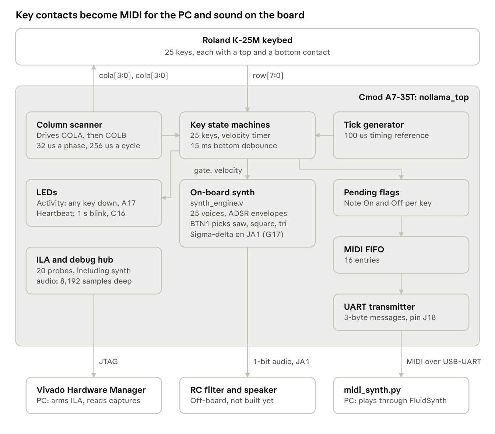
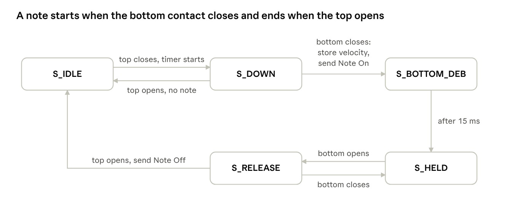
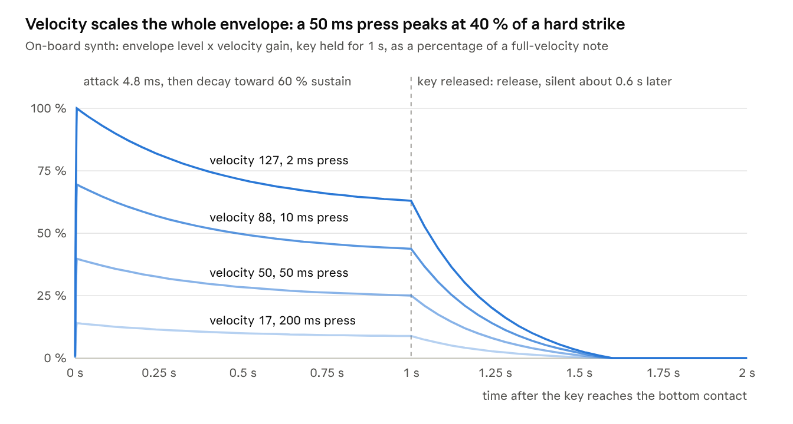

# MIDI Keyboard Scanner Design Overview

Nov 13, 2026 · @Larry Medwin and Claude

## Summary

This design turns a 25-key Roland K-25M keybed into a MIDI source and a stand-alone synthesizer, running on a Digilent Cmod A7-35T (xc7a35tcpg236-1). It scans the key matrix, measures how fast each key is struck, and sends Note On and Note Off messages over the board's USB-UART. On the PC, `midi_synth.py` plays those messages through FluidSynth. The FPGA can also play the notes itself: `synth_engine.v` sends audio out on Pmod pin JA1 to an RC filter or a Pmod AMP2.

The design is two Verilog modules, `nollama_top.v` and `synth_engine.v`, and one constraints file, `nollama_top.xdc`, built in Vivado 2025.2. All 25 keys play through the PC synth. The board clock turned out to be 100 MHz, and the design now uses it. The on-board synth passes simulation but hasn't been heard on the board yet.

| Item | Value |
| --- | --- |
| Keys | 25, C2 to C4 (MIDI notes 36 to 60) |
| Matrix | 4 columns x 8 rows, two contacts per key |
| Clock | L17, measured at 100 MHz and constrained as 100 MHz |
| MIDI output | 3-byte messages on channel 1, 31,250 baud, FPGA pin J18 |
| Audio output | 25 voices, ADSR or plucked string, 48.828 kHz sample rate, 1-bit sigma-delta on FPGA pin G17 (JA1) |
| Debug | ILA and debug hub, added through the XDC |
| Verilog sources | `midi_pluck.srcs/sources_1/imports/Downloads/nollama_top.v`, `midi_pluck.srcs/sources_1/new/synth_engine.v` |
| Constraints | `midi_pluck.srcs/constrs_1/imports/Downloads/nollama_top.xdc` |

## Project status

All 25 keys play through the PC synth since the column leads were rewired on 2026-11-10. The same day a heartbeat LED measured the 100 MHz clock, and the design was set to match. That build, which also adds the on-board synth, runs on the board: MIDI, velocity and the ILA work, and an ILA capture shows the on-board synth playing the right pitch.

| Area | Status | Notes |
| --- | --- | --- |
| Key matrix | Working | All 4 columns and 8 rows send MIDI after the 2026-11-10 rewiring |
| Verilog logic | Passes simulation | All 25 keys send the correct Note On and Note Off |
| Clock | Measured | Heartbeat LED showed about 100 MHz; `CLK_HZ` is now 100,000,000 |
| MIDI serial link | Working | The 100 MHz build sends 31,250 baud; midi\_monitor.py read Note On and Note Off with no flags on 2026-11-10 |
| Velocity | Working | Confirmed on 2026-11-10: harder strikes play louder through midi\_synth.py. Since 2026-11-11 a logarithmic curve spreads the range from 2 ms to 400 ms, and slow presses play softer as expected (confirmed 2026-11-11) |
| PC monitor and synth | Working | All notes play with no extra flags, louder for harder strikes |
| On-board synth | Passes simulation | Runs on the board: an ILA capture of A2 measured 110.0 Hz with the expected attack and decay. Was heard. |
| ILA | Working at 100 MHz | Arms, triggers and uploads 8,192 samples on the 2026-11-10 build |
| Timing | Met at 100 MHz | Worst setup slack 1.725 ns against the 10 ns constraint, in a standalone build without the ILA |

## How to play it

Everything below assumes the bitstream in `midi_pluck.runs/impl_1/` is current.

1. Plug the keybed ribbon into the Cmod A7, then plug the Cmod into the PC with its USB cable.
2. In Vivado, open Hardware Manager, choose Open Target → Auto Connect, then Program Device with `midi_pluck.runs/impl_1/nollama_top.bit` (probes file `nollama_top.ltx`). The design is loaded over JTAG, so program it again whenever the board has lost power, unless the bitstream has been written to the board's flash.
3. Check that LED2 blinks 1 s on, 1 s off. That confirms the 100 MHz clock.
4. On the PC, start the synth:

```
cd /opt/Xilinx/projects/midi_pluck
python3 midi_synth.py
```

5. Play. Harder strikes play louder; slower presses play quieter, down to velocity 1 at 400 ms or more between the top and bottom contacts. LED1 lights while any key is down. Press Ctrl-C to quit.

Tips:

- **No sound?** `midi_monitor.py` only prints notes; it makes no sound. Only one program can hold `/dev/ttyUSB1`, so stop the monitor with Ctrl-C before starting `midi_synth.py`.
- **First time on a new PC:** `midi_synth.py` needs FluidSynth and a General MIDI soundfont: `sudo apt install fluidsynth fluid-soundfont-gm`.
- **Other sounds:** `--program N` picks a General MIDI instrument; `--velocity N` forces a fixed loudness.
- **Reset:** BTN0 resets the scanner and synth without reprogramming.
- **On-board sound:** BTN1 steps the on-board synth through saw, square, triangle and pluck (a plucked string); after a reset, three presses select pluck. You only hear it with an RC filter and an amplified speaker on JA1 (see Audio output). Until that is built, an ILA capture of `dbg_synth_sample` can be saved as CSV and turned into a WAV file.

## Architecture



The scanner drives one column line at a time, and the key state machines read the rows back. From there the notes take two paths. Finished note events pass through the pending flags and FIFO to the UART, so several keys can change while the slower serial link is busy, and midi\_synth.py plays them on the PC. At the same time, each key's gate and velocity drive one voice of the on-board synth, whose 1-bit audio leaves on JA1 for an RC filter and speaker. The ILA is for debugging only.

## Hardware setup

The Cmod A7 plugs into the PC over one USB cable, which carries both JTAG and the serial link. The keybed connects directly to the Cmod's header pins through 16 leads: 8 column outputs and 8 row inputs.

### How the key matrix works

Each key has two contacts. The top contact closes early in the key's travel, and the bottom contact closes near the end. Measuring the time between them gives the strike speed.

The contacts share the 8 row lines. To read a key, the FPGA drives one column line high, and a closed contact connects that line to the key's row. Because only one column line is high at a time, a high row identifies a single contact.

Every key needs two column lines to work: COLA feeds its top contact, and COLB feeds its bottom contact.

### Key map

The design assumes the keys run in order across the matrix, which gives this layout. The six working notes fit it, but the keyboard's own wiring hasn't been confirmed.

| Row (Cmod pin) | Column 0 | Column 1 | Column 2 | Column 3 |
| --- | --- | --- | --- | --- |
| 0 (3) | C2 | G#2 | E3 | C4 |
| 1 (4) | C#2 | A2 | F3 |  |
| 2 (5) | D2 | A#2 | F#3 |  |
| 3 (6) | D#2 | B2 | G3 |  |
| 4 (7) | E2 | C3 | G#3 |  |
| 5 (8) | F2 | C#3 | A3 |  |
| 6 (9) | F#2 | D3 | A#3 |  |
| 7 (10) | G2 | D#3 | B3 |  |

### Audio output

The on-board synth's audio leaves on Pmod pin JA1 and needs a low-pass filter before an amplifier. The planned circuit is a 1 kΩ and 10 nF filter with a cutoff of about 16 kHz, then a DC-blocking capacitor. It hasn't been built yet.

```
 JA1 (G17) ──[ 1 kΩ ]──┬──────┤+ 10 µF ├──────► amplifier input (tip and ring)
                       │
                     ═══ 10 nF
                       │
 JA5 (GND) ───────────┴───────────────────► amplifier ground (sleeve)
```

| Part | Value | Purpose |
| --- | --- | --- |
| Resistor | 1 kΩ | Filter, and limits the pin current to about 3 mA |
| Capacitor | 10 nF ceramic (marked 103) | Filter |
| Capacitor | 1 to 10 µF, + side toward the FPGA | Blocks the 1.65 V DC level |

The output is up to about 1 V RMS, close to a phone's headphone level. Feed it to powered speakers or an amplifier's AUX input; headphones work but are quiet through the 1 kΩ. Never connect a bare speaker. A second identical RC stage after the first lowers any hiss.

A Digilent Pmod AMP2 in the top row of JA is the plug-in alternative, with the filter and amplifier built in. JA2 and JA4 already drive its GAIN (0) and \~SHUTDOWN (1) pins, and are left unconnected with the RC filter.

## nollama\_top.v

The module has one clock domain and an active-high asynchronous reset from `reset_btn`. Its timing constants all derive from the `CLK_HZ` parameter, so a clock change needs only that parameter and the XDC period.

| Constant | Formula | At 100 MHz | Sets |
| --- | --- | --- | --- |
| `TICK_CLKS` | `CLK_HZ / 10000` | 10,000 clocks, 100 us | Velocity and debounce timers |
| `SCAN_CLKS` | `CLK_HZ / 31250` | 3,200 clocks, 32 us | One scan phase |
| `BAUD_CLKS` | `CLK_HZ / 31250` | 3,200 clocks, 32 us | One MIDI bit |
| `ILA_DIV` | `CLK_HZ / ILA_RATE_HZ` | 2,500 clocks, 25 us | One ILA sample |
| `BTN_CLKS` | `CLK_HZ / 100` | 1,000,000 clocks, 10 ms | Waveform button sampling (debounce) |
| Heartbeat | `CLK_HZ` | 100,000,000 clocks, 1 s | LED2 toggle period |

### Column scanner

A 3-bit `scan_phase` drives one column line high at a time: `cola[0]`, `colb[0]`, `cola[1]`, and so on. The full cycle is 8 phases, or 256 us. At the end of each COLA phase the rows are saved in `top_sample`. At the end of each COLB phase the live rows and `top_sample` update the 8 keys in that column.

A key's index is `column x 8 + row`, and its MIDI note is `36 + index`. Indexes 25 to 31 are unused, so column 3 has only one key, C4.

A row gets the whole phase to settle, because it is sampled on the phase's last clock. Whether that is enough on the real wiring hasn't been measured. A contact change is seen within one 256 us cycle.

### Key state machine

Each key has its own state, a 12-bit `key_timer`, an 8-bit `deb_timer` and a stored velocity. The timer counts 100 us ticks while the key is in `S_DOWN`, from the top contact closing to the bottom contact closing. The 150-tick debounce in `S_BOTTOM_DEB` holds the key for 15 ms after Note On.



### Velocity

`calc_velocity` turns the travel time t into a MIDI velocity on a logarithmic curve, v = 127 − 126 × ln(t / 2 ms) / ln(200), limited to 1–127. Each doubling of the travel time lowers the velocity by about 16.5, so slow presses get as much of the range as fast ones. It replaced a straight-line curve on 2026-11-11, which sent velocity 1 for every press slower than about 100 ms.

| Travel time | Ticks | Velocity |
| --- | --- | --- |
| 2 ms or less | 20 or less | 127 |
| 2.1 ms to 396.7 ms | 21 to 3967 | The curve, 126 down to 2 |
| 396.8 ms or more | 3968 to 4095 | 1 |

The timer counts 100 us ticks and stops at 4095 (409.5 ms). Rather than a 4096-entry table, `vel_index` turns the tick count into a 144-entry log-spaced index, exact below 3.2 ms and then 16 steps per doubling, and a case table gives the velocity. `velocity_curve.py` in the project folder generates and checks the table: velocity only falls as the time grows, by at most 2 per tick, and an xsim run of the Verilog matched it at all 4096 tick values. Velocity never reaches 0, because a Note On with velocity 0 means Note Off.

How loud a note plays follows from its velocity. The on-board synth scales each voice by (velocity + 1) / 128, so the table gives its exact amplitude. On the PC, FluidSynth also plays harder strikes louder, but its curve comes from the soundfont, so it isn't listed here.

| Travel time | Ticks | Velocity | On-board amplitude | On-board level |
| --- | --- | --- | --- | --- |
| 2 ms | 20 | 127 | 100.0 % | 0.0 dB |
| 3 ms | 30 | 117 | 92.2 % | -0.7 dB |
| 5 ms | 50 | 105 | 82.8 % | -1.6 dB |
| 10 ms | 100 | 88 | 69.5 % | -3.2 dB |
| 20 ms | 200 | 72 | 57.0 % | -4.9 dB |
| 30 ms | 300 | 63 | 50.0 % | -6.0 dB |
| 50 ms | 500 | 50 | 39.8 % | -8.0 dB |
| 75 ms | 750 | 41 | 32.8 % | -9.7 dB |
| 100 ms | 1000 | 34 | 27.3 % | -11.3 dB |
| 150 ms | 1500 | 24 | 19.5 % | -14.2 dB |
| 200 ms | 2000 | 17 | 14.1 % | -17.0 dB |
| 250 ms | 2500 | 12 | 10.2 % | -19.9 dB |
| 300 ms | 3000 | 8 | 7.0 % | -23.1 dB |
| 350 ms | 3500 | 4 | 3.9 % | -28.2 dB |
| 400 ms or more | 4000 or more | 1 | 1.6 % | -36.1 dB |

On the on-board synth, each doubling of the travel time lowers the level by roughly 1.5 to 3 dB over most of the range, more at the slow end as the velocity nears 1.

### MIDI FIFO

Note events set bits in `note_on_pending` and `note_off_pending`. A scanner, `q_scan`, visits keys 0 to 24 in turn and moves each pending event into a 16-entry FIFO. Each 15-bit entry holds a note-on flag, the note and the velocity. A write pulses `fifo_wr_en`, which clears the pending bit.

The FIFO decouples the fast key logic from the slow UART. At 960 us per message, a full FIFO of 16 messages takes about 15.4 ms to send. If it fills, events wait in the pending flags instead of being lost.

### UART transmitter

The transmitter reads one FIFO entry and sends three bytes: status (`0x90` or `0x80`, channel 1), note, and velocity (0 for Note Off). Each byte is 8N1, LSB first, so a message takes 30 bit times, or 960 us at 31,250 baud.

| Message | Byte 1 | Byte 2 | Byte 3 | Example |
| --- | --- | --- | --- | --- |
| Note On | `0x90` | Note, 36 to 60 | Velocity, 1 to 127 | C2 at velocity 121: `90 24 79` |
| Note Off | `0x80` | Note, 36 to 60 | 0 | C2 released: `80 24 00` |

### Activity LED

`activity_led` is high while any of the 25 keys is not in `S_IDLE`. A closed top contact alone lights it.

### Heartbeat LED

`heartbeat_led` toggles every `CLK_HZ` clocks, so LED2 is on for 1 s and off for 1 s when `CLK_HZ` matches the real clock. It has no reset and keeps blinking while BTN0 is held. It was added to measure the clock, and confirmed it runs at 100 MHz.

### Synth connection

Section 3b feeds the on-board synth. A key's gate is high in `S_BOTTOM_DEB`, `S_HELD` and `S_RELEASE`, so it sounds from Note On to Note Off, the same as the MIDI output. Its stored `key_velocity` sets its loudness. The ADSR settings are the `ADSR_*` localparams, and BTN1 steps the waveform through sawtooth, square, triangle and pluck.

### Debug probes

The `dbg_*` wires carry `mark_debug` so the ILA can reach them. `ila_ce` pulses once per sample period and is the capture qualifier, because the ILA itself must keep a free-running clock. `fifo_wr_en_sticky` stretches the one-clock FIFO write pulse so a decimated capture can't miss it.

## synth\_engine.v

`synth_engine.v` plays the keyboard without the PC. Each of the 25 keys has its own oscillator, ADSR envelope and plucked-string delay line, and the mix leaves on one pin as a 1-bit sigma-delta signal. `nollama_top.v` instantiates it as `u_synth`.

### How a sample is made

Every 2,048 clocks, a 48.828 kHz sample rate, the engine processes the 25 voices one after another at 6 clocks each. A pass takes 150 clocks, and one shared set of 5 DSP multipliers serves every voice.

1. Fetch the voice's phase, envelope level and stage, and its delay-line pointer and pluck state.
2. Update the stage from the key's gate, and form the waveform from the top phase bits. Read the oldest sample of the voice's delay line from the block RAM.
3. Multiply: envelope step = (target − level) × rate, amplitude = wave × level, and the string's loop filter, (y\[n−N\] + y\[n−N−1\]) × g.
4. Write back the new level, stage and phase, and the new string sample y\[n\].
5. Scale the amplitude, or the string sample in pluck mode, by velocity: (velocity + 1) / 128.
6. Add the voice into the mix.

After voice 24 the mix is divided by 4 (`MIX_SHIFT = 2`), clipped to 16 bits and held as `sample` until the next pass. About 4 full-volume notes fit before clipping.

### Pitch

Each voice has a 24-bit phase accumulator, stepped by f × 2^24 / Fs every sample. The steps come from a table for notes 36 to 60, 65.41 Hz to 261.63 Hz, in equal temperament at A4 = 440 Hz. The table assumes 100 MHz / 2,048, so a change to the clock or `SAMPLE_DIV` needs a new table.

### Waveforms

| `wave_sel` | Waveform | Amplitude |
| --- | --- | --- |
| 0 | Sawtooth, the default after reset | Full |
| 1 | Square | Half, because a square wave sounds much louder |
| 2 | Triangle | Full |
| 3 | Pluck: a plucked string (Karplus-Strong), below | Set by the strike velocity |

### ADSR envelope

The envelope is exponential, like an analog one. Each sample, the level moves (target − level) × rate / 2^20 toward its target, so the time constant is 21.47 s / rate.

| Stage | Target | Ends when | Setting in `nollama_top.v` |
| --- | --- | --- | --- |
| Attack | 1.25 x full scale | Level reaches full scale | `ADSR_ATTACK = 7158`: tau 3 ms, full in about 5 ms |
| Decay and sustain | Sustain level | Key is released | `ADSR_DECAY = 54`: tau 400 ms; `ADSR_SUSTAIN = 153`: 60 % |
| Release | Just below zero | Level reaches zero and the voice goes idle | `ADSR_RELEASE = 86`: tau 250 ms, silent in about 0.4 s |

The overshooting targets let attack and release finish in a fixed time. A key pressed again during release restarts its attack from the current level, so it doesn't click. The settings are module inputs, so MIDI control messages from the PC could set them later without a rebuild.



*Simulated with the same integer arithmetic as synth\_engine.v and the ADSR settings in nollama\_top.v.*

The envelope has the same shape at every velocity; velocity only scales its height, through the (velocity + 1) / 128 gain. Because the sustain level is a fixed 60 % of each note's own peak, a soft note stays soft for as long as the key is held. This applies to the on-board synth only: FluidSynth on the PC uses the soundfont's own envelopes.

### Plucked string (Karplus-Strong)

`wave_sel = 3` replaces the oscillator and envelope with a Karplus-Strong plucked string. Each key has a delay line one period long, N samples, in a shared block RAM. Every sample, the voice reads the oldest value, y\[n−N\], adds the value it read on the previous sample, y\[n−N−1\], halves the sum, scales it by a loop gain g just below 1, and writes the result back as the newest value:

```
y[n] = sat16( g × (y[n−N] + y[n−N−1]) / 2 + excitation )
```

The 2-point average makes the loop N + 0.5 samples long. It also dulls the tone a little on every pass, so the high harmonics die first, as on a real string. There is no envelope: the loop shapes the whole sound.

- **Strike:** a key press, seen as the ADSR entering attack, adds N samples of noise from a 32-bit LFSR, filling the delay line once. The noise passes through a one-pole low-pass whose coefficient rises with velocity, from 16/128 at velocity 1 to 127/128 at 127, so harder strikes sound brighter. The noise is multiplied by 4 so a full-velocity pluck starts about as loud as a sawtooth note, and the output is scaled by (velocity + 1) / 128 like the other waveforms.
- **Ring and release:** while the key is held, g gives a ring time (to −60 dB) of 4 s at C2, falling to 2 s at C4. On release a second gain damps the string to −60 dB in 0.12 s, like a muted string. Striking a key that is still ringing adds new noise on top.
- **Tuning:** N is a whole number of samples, so each note is within ±3.5 cents of equal temperament.
- **Resources:** the 25 delay lines hold 10,149 samples in one 16K × 16 block RAM, 8 of the 50 RAMB36 tiles. Each voice's pointer, previous sample, noise counter and filter state sit in small distributed RAMs.

| Note | N (samples) | Ring time while held | Tuning error |
| --- | --- | --- | --- |
| C2, 65.41 Hz | 746 | 4.0 s | +0.1 cents |
| A2, 110.00 Hz | 443 | 3.1 s | +1.5 cents |
| C3, 130.81 Hz | 373 | 2.8 s | −1.1 cents |
| A3, 220.00 Hz | 221 | 2.2 s | +3.5 cents |
| C4, 261.63 Hz | 186 | 2.0 s | +1.2 cents |

`pluck_tables.py` in the project folder generates the four per-note tables in `synth_engine.v` (`ks_len`, `ks_base`, `ks_ghold` and `ks_grel`) and models the voice with the same integer arithmetic. `python3 pluck_tables.py` prints all 25 notes; `python3 pluck_tables.py wav pluck_demo.wav` writes an 18-second demo, with single notes, three velocities, a chord and repeated notes, to hear on the PC without the board.

#### Switching to pluck

There are no tables or files to load. The four per-note tables are `case` statements that synthesis builds into the bitstream, and the delay-line RAM starts at all zeros when the FPGA is configured.

1. Make sure the board runs a bitstream built on or after 2026-11-13. A JTAG load is lost at power-off, and a flash image written before then boots the older three-waveform design, so program or reflash `nollama_top.bit` if in doubt.
2. After programming or a BTN0 reset, press BTN1 three times: saw → square → triangle → pluck. In the ILA, `dbg_wave_sel` reads 3.
3. Play. A fourth press goes back to saw.

Both voices run for every key on every sample, whatever the setting; `wave_sel` only chooses which one reaches the mix. A key already held when you switch to pluck stays silent until it is struck again, because a string only sounds after a strike.

#### The pluck sequence

The life of one note:

1. **Key down.** The key's gate rises when the bottom contact closes. On that voice's next sample the ADSR enters attack, and the engine takes this as a strike: it sets the voice's noise counter to N.
2. **Excitation, N samples.** One period: 15.3 ms at C2, 3.8 ms at C4. Each sample adds a new low-passed noise value, times 4, to the string's output and writes the sum into the delay line. After one period the line holds a full period of noise.
3. **Ring.** The noise keeps circulating. Every pass averages neighbouring samples, which dulls the tone, and multiplies by G\_HOLD, which sets the decay. Because the same period repeats, the noise turns into a pitched tone within a few passes.
4. **Key up.** The gate falls when the top contact opens, and the loop gain switches to G\_REL, which damps the string to −60 dB in 0.12 s.
5. **Silence.** The string keeps running with values near zero; nothing needs resetting. A new strike adds fresh noise on top of whatever is left.

Each sample, the engine spends 6 clocks on each voice, and both the ADSR voice and the pluck voice are computed in the same steps:

| Step | ADSR voice | Pluck voice |
| --- | --- | --- |
| 0 | Fetch phase, level, stage, gate and velocity | Fetch the delay-line pointer, previous sample, noise counter and noise filter state; look up N, the RAM offset, G\_HOLD and G\_REL; take a 15-bit noise value from the LFSR |
| 1 | Update the stage from the gate; form the waveform | Read y\[n−N\] from the RAM at offset + pointer; detect a strike; multiply (noise − filter state) × brightness |
| 2 | Multiply: envelope step and amplitude | Multiply (y\[n−N\] + y\[n−N−1\]) × g, with g = G\_HOLD while held or G\_REL after release; update the noise filter; count the noise down |
| 3 | Write back level, stage and phase | Form y\[n\] = sat16(product / 2^17 + 4 × noise while exciting); write y\[n\] to the RAM; advance the pointer, wrapping at N; keep y\[n−N\] as the next previous sample |
| 4 | Both: multiply by (velocity + 1) / 128, using the pluck output when `wave_sel` = 3 and the ADSR amplitude otherwise |  |
| 5 | Both: add the result into the mix |  |

After voice 24, the mix is divided by 4, clipped to 16 bits and held as the sample until the next pass, as for the other waveforms.

### Sigma-delta output

A first-order sigma-delta modulator updates every 4 clocks, at 25 MHz. Its density of ones follows the sample, so silence is 50 % ones, 1.65 V on average. Its noise sits far above hearing, so one RC filter is enough.

### Verification

`midi_pluck.srcs/sim_1/new/tb_synth_engine.v` presses and releases A3 and A2 and logs every sample; it isn't added to the project. In xsim, A3 measured 219.95 Hz as a sawtooth and 220.00 Hz as a triangle, against 220.00 Hz. The envelope went through attack, decay to the sustain level, release and idle, and nothing clipped. The square wave and BTN1 weren't simulated. For pluck mode, tb\_pluck.v (in midi\_pluck.srcs/sim\_1/new) strikes C2, A2, C3 and C4 at velocities 127, 40, 1 and 90, releases them, and strikes A2 again while it still rings. All 14,000 samples (287 ms) match pluck\_tables.py exactly, and adding pluck mode left every ADSR sample unchanged.

## nollama\_top.xdc

The XDC sets the 10 ns (100 MHz) clock period, assigns every port to a pin and defines the debug core. All I/O is LVCMOS33. The Cmod pin numbers below come from Digilent's `Cmod-A7-Master.xdc`.

| Port | Direction | FPGA pin | Cmod pin | Purpose |
| --- | --- | --- | --- | --- |
| `clk` | Input | L17 | On board | Clock, 100 MHz |
| `reset_btn` | Input | A18 | On board | BTN0, active high |
| `wave_btn` | Input | B18 | On board | BTN1, steps the synth waveform |
| `activity_led` | Output | A17 | On board | LED1 |
| `heartbeat_led` | Output | C16 | On board | LED2, 1 s on and 1 s off |
| `midi_tx` | Output | J18 | On board | USB-UART to the PC |
| `cola[0]` | Output | M3 | 1 | Top contacts, column 0 |
| `colb[0]` | Output | L3 | 2 | Bottom contacts, column 0 |
| `row[0]` | Input | A16 | 3 | Row sense |
| `row[1]` | Input | K3 | 4 | Row sense |
| `row[2]` | Input | C15 | 5 | Row sense |
| `row[3]` | Input | H1 | 6 | Row sense |
| `row[4]` | Input | A15 | 7 | Row sense |
| `row[5]` | Input | B15 | 8 | Row sense |
| `row[6]` | Input | A14 | 9 | Row sense |
| `row[7]` | Input | J3 | 10 | Row sense |
| `cola[3]` | Output | J1 | 11 | Top contacts, column 3 |
| `cola[2]` | Output | K2 | 12 | Top contacts, column 2 |
| `cola[1]` | Output | L1 | 13 | Top contacts, column 1 |
| `colb[3]` | Output | L2 | 14 | Bottom contacts, column 3 |
| `colb[2]` | Output | M1 | 17 | Bottom contacts, column 2 |
| `colb[1]` | Output | N3 | 18 | Bottom contacts, column 1 |
| `amp_ain` | Output | G17 | JA1 | Synth audio, 1-bit sigma-delta |
| `amp_gain` | Output | G19 | JA2 | Pmod AMP2 gain select, tied 0 |
| `amp_shutdown_n` | Output | L18 | JA4 | Pmod AMP2 enable, tied 1 |

All eight row inputs use internal pull-downs, so a row reads low unless a closed contact connects it to the driven column.

The column leads were rewired on 2026-11-10 and the XDC changed to match, which is why columns 1 to 3 no longer sit in order on the header. The XDC keeps the earlier assignments as comments.

### Debug core

| Setting | Value |
| --- | --- |
| ILA clock | `clk_IBUF_BUFG`, free running |
| Depth | 1,024 samples, or 25.6 ms at 25 us per sample |
| Storage qualification | Enabled; capture condition `dbg_ila_ce == 1` |
| Advanced trigger | Enabled |
| Probes | 17 (`probe0` to `probe16`) |
| Debug hub clock | `clk_IBUF_BUFG`, divider off |

The probes cover the column and row lines, `top_sample`, the scan phase and active column, key 0's state and timer, the last struck key and velocity, the FIFO count and write events, the transmitter state, `midi_tx`, the activity LED and `ila_ce`. Three synth probes were added on 2026-11-10: dbg\_synth\_ce (one pulse per audio sample), dbg\_synth\_sample (the 16-bit mix) and dbg\_wave\_sel. With capture condition dbg\_synth\_ce == 1 the ILA records the audio at 48.828 kHz; with dbg\_ila\_ce == 1 it records at 40 kHz. Either way the samples can be saved as CSV and turned into a WAV file to listen to without a filter.

The debug hub's `C_CLK_INPUT_FREQ_HZ` is now 100 MHz, and the old 300 MHz line is commented out. On the 2026-11-10 build that setting raised critical warning `Common 17-55`, because the XDC runs it before the debug hub exists, so it may not take effect.

## Bringing up the column leads

The leads were rewired on 2026-11-10, and all 25 keys now play. This procedure is kept for reference if a lead fails again.

Fix the six dead leads as three pairs, not one at a time, because a note needs both leads of its column. Use the activity LED and a meter to judge each lead on its own. The fault results below come from simulating column 1 with each fault in place.

| Column | COLA pin (top contact) | COLB pin (bottom contact) | Test key (row 0) |
| --- | --- | --- | --- |
| 1 | Cmod 12 | Cmod 11 | G#2 |
| 2 | Cmod 13 | Cmod 14 | E3 |
| 3 | Cmod 17 | Cmod 18 | C4 |

The test keys all use row 0, which C2 already proves. Turn the power off before moving a lead, and keep meter probes from bridging neighbouring pins.

### Step 1: Measure at the Cmod header

Each column line is high 12.5% of the time, so a DC meter reads about 0.41 V on a healthy line, not 3.3 V. This holds whatever the clock frequency is.

1. Put the black probe on GND. Cmod pin 25 is GND, and pin 24 is 5 V USB power, so confirm both on the board first.
2. Measure pins 1 and 2 as a reference, since those leads work.
3. Measure pins 11, 12, 13, 14, 17 and 18. Each should match the reference.

A pin that reads about 0 V points to the FPGA or board, not the lead.

### Step 2: Measure at the keyboard end

Repeat the measurement at the keyboard end of each lead. About 0.41 V means the lead is intact to that point. About 0 V means the break is in that lead or its connector.

Also check the header count. Pins 15 and 16 exist physically but aren't used, so leads placed on 11 to 16 in a row would put the last two in the wrong place.

### Step 3: Test one column pair at a time

Work through columns 1, 2 and 3. Press and hold the column's test key and compare the results:

| Activity LED while held | MIDI result | Meaning | Action |
| --- | --- | --- | --- |
| Off | Nothing | COLA isn't reaching the top contact | Fix COLA first |
| On | Nothing | COLA is good; COLB isn't reaching the bottom contact | Keep COLA, move only COLB |
| On | Correct note, always velocity 127 | COLA and COLB are swapped | Swap the pair |
| On | Wrong note | The pair is on another column's contacts | Move the pair |
| On | Correct note, varying or stuck at 1 | The pair is correct | Go to the next column |

Once a pair works, leave it alone. Moving leads is faster than editing the XDC, which needs a rebuild each time.

### Step 4: Check rows 6 and 7

Once a column plays, test its row 6 and row 7 keys: D3 and D#3 on column 1. If those stay silent while the column's other keys play, check the leads on Cmod pins 9 and 10.

## Build and debug workflow

The normal cycle is to edit the sources, build a bitstream in Vivado and program the board over USB. A lead moved on the bench needs no rebuild, but any `.v` or `.xdc` change does.

1. Run Synthesis, Implementation and Generate Bitstream.
2. Open Hardware Manager and program `midi_pluck.runs/impl_1/nollama_top.bit`, with `nollama_top.ltx` as the probes file.
3. Stop any program using the serial port before starting another, because only one can read it.

`synth_engine.v` must be in the project's design sources. If Vivado doesn't list it, add it from the Tcl console with `add_files -norecurse /opt/Xilinx/projects/midi_pluck/midi_pluck.srcs/sources_1/new/synth_engine.v`.

### Writing the bitstream to flash

The Cmod A7 loads its design from its 4 MB Quad-SPI flash at every power-up, so a bitstream written there survives a power cycle with no jumper to set. A JTAG load still works but lasts only until power is lost; reflash each bitstream that should stick.

1. Add these configuration settings to `nollama_top.xdc`, then regenerate the bitstream:

```tcl
set_property CFGBVS VCCO [current_design]
set_property CONFIG_VOLTAGE 3.3 [current_design]
set_property BITSTREAM.CONFIG.SPI_BUSWIDTH 4 [current_design]
set_property BITSTREAM.CONFIG.CONFIGRATE 33 [current_design]
set_property BITSTREAM.GENERAL.COMPRESS TRUE [current_design]
```

2. Make a flash image. Either tick `-bin_file` under Settings → Bitstream, so Generate Bitstream also writes `midi_pluck.runs/impl_1/nollama_top.bin`, or run this in the Tcl console:

```tcl
write_cfgmem -format mcs -size 4 -interface SPIx4 \
  -loadbit {up 0x0 midi_pluck.runs/impl_1/nollama_top.bit} \
  -force midi_pluck.runs/impl_1/nollama_top.mcs
```

3. In Hardware Manager, Open Target → Auto Connect, right-click `xc7a35t_0` and choose Add Configuration Memory Device. Pick the part on the board: MX25L3233F on newer boards (search "3233"), Micron N25Q032A on older ones (search "n25q32"). The 8-pin chip's marking says which. This board has the Micron part: Vivado reads its ID as 20 BA 16 and needs n25q32-3.3v-spi-x1\_x2\_x4. Vivado 2025.2 has no MX25L3233F entry; for that chip, choose mx25l3273f-spi-x1\_x2\_x4.
4. Program the configuration memory device with the `.bin` or `.mcs` file, with Erase, Program and Verify ticked.
5. Unplug and replug the USB cable. The heartbeat LED should blink without Vivado. To debug a flash-booted design, connect Hardware Manager and set the probes file to `nollama_top.ltx` by hand.

   To check that the flash holds the current design, run `midi_synth.py` and press BTN1. Each press prints a line such as `c0 50  Program ch 1  80 (GM 81)`. No `Program` line means the flash still holds an image from before 2026-11-17, which sends notes only, so the PC instrument never changes.

Sources: [Cmod A7 Reference Manual](https://reference.digilentinc.com/cmod_a7/refmanual), [Cmod A7 Programming Guide](https://reference.digilentinc.com/cmod_a7/pg).

### Capturing with the ILA

The ILA always runs on the free-running clock, because decimating or gating that clock caused the earlier `clock has stopped` error. To span a longer time, set Capture Mode to BASIC with the capture condition `dbg_ila_ce == 1`. This stores one sample every 25 us, and the setting doesn't need a rebuild.

Keep the JTAG frequency at or below about 4.8 MHz, because the debug hub clock must be at least 2.5 times the JTAG rate.

The ILA shows signals inside the FPGA, so `dbg_cola` and `dbg_colb` show what the logic drives, not what reaches the keyboard. `dbg_row` does reflect the real input pins, which makes it useful for checking whether a contact is getting through.

### Listening to an ILA audio capture

An ILA capture of `dbg_synth_sample` can be saved as CSV and turned into a WAV file, so the on-board synth can be heard without the RC filter and speaker. One 8,192-sample capture is short: 168 ms at 48.828 kHz, or 205 ms at 40 kHz.

| Capture condition | Sample rate | 8,192 samples last | `--rate` |
| --- | --- | --- | --- |
| `dbg_synth_ce == 1` | 48.828 kHz (every 2,048 clocks) | 167.8 ms | 48828 (default) |
| `dbg_ila_ce == 1` | 40 kHz (every 2,500 clocks) | 204.8 ms | 40000 |

1. In Hardware Manager, set Capture Mode to BASIC with the capture condition `dbg_synth_ce == 1`. Set the trigger to `dbg_activity_led` = R (rising edge) and the trigger position to about 500, so the capture starts just before a key goes down.
2. Run the trigger, then strike and hold a key until the capture fills.
3. Export the capture as CSV: in the waveform window, click Export ILA Data and pick CSV, or in the Tcl console run:

```tcl
write_hw_ila_data -force -csv_file synth_capture.csv [current_hw_ila_data]
```

4. Save the script below as `ila_to_wav.py` and run it on the CSV. It finds the `dbg_synth_sample` column, reads each value in the radix Vivado wrote (hex by default), treats it as signed 16-bit and writes a mono 16-bit WAV. `--repeat` loops the capture so it is long enough to hear.

```bash
python3 ila_to_wav.py synth_capture.csv synth_capture.wav --repeat 6
# capture taken with dbg_ila_ce == 1:
python3 ila_to_wav.py synth_capture.csv synth_capture.wav --rate 40000 --repeat 5
```

5. Play `synth_capture.wav` in any audio player, for example `aplay synth_capture.wav`.

```python
#!/usr/bin/env python3
"""Turn an ILA CSV capture of dbg_synth_sample into a 16-bit mono WAV."""
import argparse, csv, struct, wave

p = argparse.ArgumentParser()
p.add_argument("csv_file")
p.add_argument("wav_file")
p.add_argument("--rate", type=int, default=48828,
               help="48828 for dbg_synth_ce captures, 40000 for dbg_ila_ce")
p.add_argument("--repeat", type=int, default=1,
               help="loop the capture this many times")
a = p.parse_args()

with open(a.csv_file, newline="") as f:
    rows = list(csv.reader(f))

head = rows[0]
col = next(i for i, h in enumerate(head)
           if h.strip().startswith("dbg_synth_sample"))

# Vivado's second row gives each column's radix, e.g. "HEX"
has_radix = rows[1][0].lower().startswith("radix")
radix = rows[1][col].upper() if has_radix else "HEX"
data = rows[2:] if has_radix else rows[1:]

samples = []
for r in data:
    v = r[col].strip()
    if not v:
        continue
    if "HEX" in radix:
        n = int(v, 16)
    elif "BIN" in radix:
        n = int(v, 2)
    else:
        n = int(v)
    if n >= 32768:          # unsigned -> signed 16-bit
        n -= 65536
    samples.append(n)

with wave.open(a.wav_file, "wb") as w:
    w.setnchannels(1)
    w.setsampwidth(2)
    w.setframerate(a.rate)
    w.writeframes(struct.pack(f"<{len(samples)}h", *samples) * a.repeat)

print(f"{len(samples)} samples, {len(samples) / a.rate * 1000:.0f} ms "
      f"x {a.repeat} -> {a.wav_file}")
```

A looped capture clicks at each joint unless the capture ends near zero. Hold the key past the decay, or release it inside the window, for a cleaner loop.

## PC software

Two Python scripts in the project folder read the serial port. They use `termios2` because 31,250 is not a standard Linux baud rate.

| Script | Purpose | Command on the 100 MHz build |
| --- | --- | --- |
| `midi_monitor.py` | Prints each message with a timestamp, note name and velocity, and reports stray bytes | `./midi_monitor.py /dev/ttyUSB1` |
| `midi_synth.py` | Plays notes through FluidSynth using the FluidR3 General MIDI soundfont | `./midi_synth.py` |

Neither script needs extra flags. `--program N` picks a General MIDI instrument from 0 to 127, `--velocity N` forces a fixed loudness, and `--audio-driver` selects the audio output.

## Project files

| Path | Contents |
| --- | --- |
| `midi_pluck.xpr` | Vivado project |
| `midi_pluck.srcs/sources_1/imports/Downloads/nollama_top.v` | Active top-level Verilog |
| `midi_pluck.srcs/sources_1/new/synth_engine.v` | On-board synth |
| `midi_pluck.srcs/constrs_1/imports/Downloads/nollama_top.xdc` | Active constraints |
| `midi_pluck.srcs/sim_1/new/tb_synth_engine.v` | Synth testbench, not added to the project |
| `midi_pluck.runs/impl_1/` | Bitstream, probes file and reports |
| `midi_monitor.py`, `midi_synth.py` | PC software |
| `pluck_tables.py` | Pluck tables for `synth_engine.v` and a bit-exact model of the pluck voice; writes demo WAVs |
| `pluck_demo.wav` | 18-second pluck demo from the model |
| `midi_pluck.srcs/sim_1/new/tb_pluck.v` | Pluck testbench, not added to the project |
| `backup_before_heartbeat/` | Version with the 2026-11-10 wiring, before the heartbeat LED |
| `backup_before_mmcm/` | Version before the MMCM work |
| `backup_mmcm_100mhz/` | 100 MHz MMCM version and its testbench |
| `design_overview.md` | Saved copy of this overview; doesn't update automatically |

## Known issues

The wiring and clock problems are fixed. What remains is hearing the on-board synth through a filter, plus smaller mismatches in the source files.

| Issue | Evidence | Next step |
| --- | --- | --- |
| On-board audio hasn't been heard | xsim and an on-board ILA capture confirm pitch and envelope; no filter is on the board yet | Build the RC filter on JA1 and listen |
| Debug hub frequency may not take effect | The XDC's `C_CLK_INPUT_FREQ_HZ` line still raises Common 17-55, but the ILA works at 100 MHz anyway | Check it in the implemented design, or set it through the debug setup wizard |
| Pmod AMP2 gain level unconfirmed | `amp_gain` is tied to 0, but which level gives the lower gain wasn't checked | Read the AMP2 manual before using one |
| The Verilog header comment is out of date | The `cola` and `colb` port comments still list the original pins, not the 2026-11-10 wiring. | Update the comment. |
| Row inputs have no synchronizers | `row` goes straight into the key state machines from the external contacts. | Add two-stage synchronizers. |

### The clock is 100 MHz

L17 runs at 100 MHz, measured on 2026-11-10 with the heartbeat LED. `CLK_HZ = 100_000_000` and `create_clock -period 10.000` match it, with no MMCM.

## Project history

| Date | Event | Result |
| --- | --- | --- |
| 2026-11-13 | Pluck bitstream written to the configuration flash (`nollama_top.bin`, Micron N25Q032A) | Erase, program and verify passed; the FPGA rebooted from flash with DONE high and the ILA core present |
| 2026-11-13 | Pluck waveform added: a Karplus-Strong plucked string as `wave_sel` 3, so BTN1 now cycles four waveforms; `pluck_tables.py` generates its tables and models it | xsim matches the model on all 14,000 samples; ADSR output and MIDI bytes unchanged. No new warnings; timing met (0.18 ns slack); board programmed. Not yet heard on the board |
| 2026-11-11 | Remaining synthesis and constraint warnings fixed: synth sequencer split into a reset control block and a no-reset datapath, FIFO memory and UART packet bytes written from no-reset blocks, only the used bits of the envelope product kept, dbg\_hub clock setting moved after the hub is created | No 8-7137, 8-4767 or 8-3936 warnings and no critical warnings; voice tables and FIFO now in distributed RAM. synth\_engine output identical in xsim; a top-level testbench sends the same MIDI bytes as before. Timing met (0.17 ns slack); board programmed |
| 2026-11-11 | Synthesis warnings fixed: FIFO and UART signals declared before use, synth\_engine helpers made combinational, key\_idx replaced by scan\_key; velocity table printed 4 entries a line | No 8-6901 or 8-6014 warnings left. synth\_engine output identical in xsim; nollama\_top now compiles in xsim. Timing met (0.21 ns slack); board programmed |
| 2026-11-11 | Velocity curve made logarithmic over 2 ms to 400 ms; key\_timer widened to 12 bits | Slow presses were all velocity 1. xsim matches the table at all 4096 ticks; timing met (0.07 ns slack, on an ILA path); confirmed by ear: slow presses now play softer |
| 2026-11-11 | calc\_velocity changed so velocity fades smoothly past 90 ms | Velocity reaches 1 at 100.8 ms instead of dropping from 15 to 1 at 90 ms. Timing met (0.27 ns slack); board programmed |
| 2026-11-10 | synth\_engine.v added to the project, synth ILA probes added, ILA depth 8,192; first 100 MHz board test | Timing met (0.34 ns slack). MIDI works at 31,250 baud; A2 captured at 110.0 Hz; velocity confirmed by ear (slow presses read 1, hard strikes play louder) |
| 2026-11-10 | On-board synth added: `synth_engine.v`, BTN1 waveform select, audio on JA1 | Passes xsim and 100 MHz timing; not yet heard on the board |
| 2026-11-10 | `CLK_HZ` changed to 100 MHz | Timing met; not yet run on the board |
| 2026-11-10 | Heartbeat LED added on LED2 | Flickered about 4 times a second: the clock is 100 MHz |
| 2026-11-10 | Column leads rewired and XDC changed to match | All 25 keys play through `midi_synth.py` |
| 2026-11-06 | Six column leads still dead after checks | Bench procedure written |
| 2026-11-05 | `cola[1]` and `colb[1]` swapped in the XDC and rebuilt | Column 1 still silent |
| 2026-11-05 | Notes above F2 found missing | All 25 keys pass simulation; wiring suspected |
| 2026-11-05 | `midi_synth.py` added | Low notes play through FluidSynth |
| 2026-11-05 | Velocity found stuck at 1 and stray bytes seen | Clock frequency questioned |
| 2026-11-05 | Returned to the earlier sources | ILA arms and captures again |
| 2026-11-04 | 100 MHz MMCM version built | Passed simulation and timing, but Hardware Manager reported `Labtools 27-3176` |
| 2026-11-04 | `clock has stopped` ILA error fixed | ILA moved from a gated clock to the free-running clock |

## Source files

The full sources are in this repository rather than copied here:
[`nollama_top.v`](../midi_pluck.srcs/sources_1/imports/Downloads/nollama_top.v),
[`nollama_top.xdc`](../midi_pluck.srcs/constrs_1/imports/Downloads/nollama_top.xdc) and
[`synth_engine.v`](../midi_pluck.srcs/sources_1/new/synth_engine.v).
